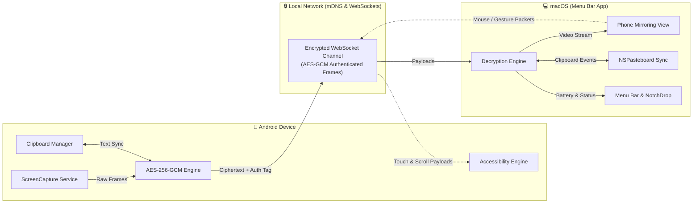

<div align="center">

  # ⚡ AirLink

  ### The Secure, Zero-Latency Bridge Between Android and macOS

  [](https://github.com/HardikParmar-1111/AirLink/releases)
  [](https://github.com/HardikParmar-1111/AirLink)
  [](https://github.com/HardikParmar-1111/AirLink)
  [](LICENSE)
  [](https://github.com/HardikParmar-1111/AirLink)

  <br />

  <!-- Hero Banner Image Placeholder -->
  

  <p align="center">
    <strong>AirLink</strong> seamlessly unifies your Android phone and Mac into a coherent ecosystem. Experience real-time screen streaming, interactive touch injection, cross-platform clipboard synchronization, and live telemetry—all over a local encrypted network.
  </p>

  <p align="center">
    <a href="#-quick-start">Quick Start</a> •
    <a href="#-key-features">Key Features</a> •
    <a href="#-architecture">Architecture</a> •
    <a href="#-tech-stack">Tech Stack</a> •
    <a href="#-building-from-source">Building from Source</a> •
    <a href="#-contributing">Contributing</a>
  </p>

</div>

---

## 📑 Table of Contents

- [Overview](#-overview)
- [Key Features](#-key-features)
- [Architecture & Security](#-architecture--security)
- [Quick Start](#-quick-start)
  - [macOS Client](#1-macos-client)
  - [Android Client](#2-android-client)
- [Building from Source](#-building-from-source)
  - [Android (`.apk`)](#prerequisites-for-android)
  - [macOS (`AirLink.app`)](#prerequisites-for-macos)
- [Tech Stack](#-tech-stack)
- [Permissions & Privacy](#-permissions--privacy)
- [Troubleshooting](#-troubleshooting)
- [Contributing](#-contributing)
- [License](#-license)

---

## 💡 Overview

AirLink bridges the gap between Google's Android and Apple's macOS ecosystem without relying on third-party cloud relays or proprietary subscriptions. Operating entirely over your local Wi-Fi, AirLink provides an Apple-native Continuity experience with hardware-accelerated video rendering, bidirectional clipboard mirroring, and bi-directional peripheral interaction.

---

## ✨ Key Features

<table>
  <tr>
    <td width="50%">
      <h3>📱 Seamless Screen Mirroring</h3>
      <p>Low-latency, high-fps screen projection from Android to macOS. Enjoy smooth visual output with responsive window scaling and native macOS rendering.</p>
    </td>
    <td width="50%">
      <h3>🖱️ Remote Trackpad & Control</h3>
      <p>Directly interact with your Android device using your Mac's trackpad and mouse. Native tap, swipe, and scroll gestures are translated into Android input events via accessibility integration.</p>
    </td>
  </tr>
  <tr>
    <td width="50%">
      <h3>📋 Universal Clipboard Sync</h3>
      <p>Copy text, URLs, or code on Android and paste instantly on Mac (or vice-versa). Instant bidirectional synchronization ensures frictionless workflow continuity.</p>
    </td>
    <td width="50%">
      <h3>🔒 Hardened AES-256-GCM Encryption</h3>
      <p>Zero plaintext on the wire. Every screen frame and telemetry payload is authenticated and encrypted with 256-bit symmetric keys, 12-byte initialization vectors (IV), and 128-bit authentication tags.</p>
    </td>
  </tr>
  <tr>
    <td width="50%">
      <h3>🔋 Real-Time Device Telemetry</h3>
      <p>Monitor your phone's battery percentage and charging state directly from the macOS Menu Bar and Notch Drop overlay.</p>
    </td>
    <td width="50%">
      <h3>⚡ Resilient WebSocket Layer</h3>
      <p>Self-healing local network socket with automatic reconnect logic, keepalive heartbeats, and zero disruption during brief network interruptions.</p>
    </td>
  </tr>
</table>

---

## 🛡️ Architecture & Security

AirLink is engineered around a peer-to-peer local network topology:



- **Zero Cloud Dependence**: Data never leaves your local Wi-Fi subnet.
- **Authenticated Encryption**: Uses `AES/GCM/NoPadding` with non-repeating cryptographically secure IVs to protect against eavesdropping and replay attacks.
- **Fail-Safe Socket Architecture**: Decoupled dispatch queues handle heavy video streaming without choking touch event ingestion or clipboard state changes.

---

## 🚀 Quick Start

Get up and running in under two minutes using our pre-compiled release artifacts.

### 1. macOS Client

1. Navigate to the **[Latest Release](https://github.com/HardikParmar-1111/AirLink/releases/latest)** page and download `AirLink-macOS-v1.0.0.zip`.
2. Extract the archive and drag **AirLink.app** into your `/Applications` directory.
3. Launch **AirLink**.
   > **Note on Gatekeeper:** If macOS blocks launch with an *unidentified developer* warning:
   > - Right-click **AirLink.app** and select **Open**.
   > - Click **Open** in the confirmation dialog, or enable it under **System Settings** → **Privacy & Security**.

### 2. Android Client

1. Download the `AirLink-Android-v1.0.apk` from the **[Releases](https://github.com/HardikParmar-1111/AirLink/releases/latest)** tab onto your phone.
2. Install the APK (allow *Install unknown apps* for your browser/file manager if prompted).
3. Open the **AirLink** app and grant the necessary permissions:
   - **Screen Recording (MediaProjection)**: Required to stream your display.
   - **Accessibility Service**: Required to allow remote touch and gestures from your Mac.
   - **Notification & Battery Access**: Optional for real-time status indicators.
4. Ensure both your Mac and Android devices are connected to the **same Wi-Fi network**. The app will discover your host and connect automatically.

---

## 🛠️ Building from Source

### Prerequisites for Android
- **Android Studio** Ladybug (2024.2+) or later
- **JDK 17**
- Android SDK Platform 35 (`minSdk 26`, `targetSdk 35`)

```bash
# Clone the repository
git clone https://github.com/HardikParmar-1111/AirLink.git
cd AirLink/"AirLink mobile"

# Assemble the release build
./gradlew assembleRelease
```
The compiled APK will be generated under `app/build/outputs/apk/release/`.

---

### Prerequisites for macOS
- **macOS Sonoma (14.0)** or later
- **Xcode 15.0+** with Command Line Tools installed

```bash
cd ../"AirLink Mac"

# Build using xcodebuild or open AirLink.xcodeproj directly in Xcode
xcodebuild -project AirLink.xcodeproj \
           -scheme AirLink \
           -configuration Release \
           -derivedDataPath ./build clean build
```

---

## 💻 Tech Stack

| Domain | Technology / Library | Purpose |
| :--- | :--- | :--- |
| **Android UI** | Jetpack Compose & Material 3 | Modern, reactive configuration interface |
| **Android Core** | Kotlin, Coroutines & Flow | Asynchronous I/O and state orchestration |
| **Display Capture** | Android `MediaProjectionManager` | Low-overhead screen capture |
| **Input Injection**| `AccessibilityService` API | Remote cursor, tap, scroll, and drag synthesis |
| **macOS Native** | Swift 5.9, SwiftUI & AppKit | Menu Bar resident utility and overlay window |
| **Video Engine** | CoreGraphics & Native Canvas | Hardware-accelerated frame rendering |
| **Networking** | WebSockets & mDNS / Bonjour | P2P discovery and low-latency duplex streaming |
| **Security** | Java Cryptography Architecture & CryptoKit | End-to-end AES-256-GCM cryptographic suite |

---

## 🔒 Permissions & Privacy

AirLink is privacy-first. We do not track telemetry, display ads, or communicate with external servers.

| Platform | Permission | Rationale |
| :--- | :--- | :--- |
| **Android** | `MEDIA_PROJECTION` | Encodes screen pixels to stream to your Mac monitor. |
| **Android** | `ACCESSIBILITY_SERVICE` | Translates Mac trackpad movements and clicks into on-screen gestures. |
| **Android** | `ACCESS_NETWORK_STATE` & `INTERNET` | Facilitates local socket transport over the shared Wi-Fi network. |
| **Android** | `BIND_NOTIFICATION_LISTENER_SERVICE` | Forwards incoming alerts to macOS (optional). |
| **macOS** | Local Network Access | Discovers and receives data packets from the Android client. |

---

## ❓ Troubleshooting

<details>
<summary><strong>Devices do not discover each other on the network</strong></summary>

- Confirm that both your Mac and Android phone are on the exact same Wi-Fi subnet (e.g., both on the 5 GHz band).
- Disable AP/Client Isolation on your Wi-Fi router, as it prevents devices from talking directly to one another.
- Ensure macOS Firewall or third-party filtering tools (Little Snitch, LuLu) permit inbound connections to AirLink.
</details>

<details>
<summary><strong>Trackpad clicks do not register on Android</strong></summary>

- Verify that **AirLink Accessibility Service** is enabled in Android **Settings** → **Accessibility** → **Installed Apps**.
- Battery optimization may kill background services on certain OEMs (Samsung, Xiaomi); set AirLink's battery usage to *Unrestricted*.
</details>

<details>
<summary><strong>High latency or dropped frames</strong></summary>

- Connect to a 5 GHz Wi-Fi network rather than 2.4 GHz to minimize interference.
- Lower the display capture resolution inside the Android app settings if running on budget hardware.
</details>

---

## 🤝 Contributing

Contributions make the open-source community an incredible place to learn, inspire, and create. Any contributions you make are **greatly appreciated**.

1. Fork the Project
2. Create your Feature Branch (`git checkout -b feature/AmazingFeature`)
3. Commit your Changes (`git commit -m 'Add some AmazingFeature'`)
4. Push to the Branch (`git push origin feature/AmazingFeature`)
5. Open a Pull Request

---

## 📄 License

Distributed under the **MIT License**. See [`LICENSE`](LICENSE) for more information.

---

<div align="center">
  <sub>Engineered with precision for cross-platform interoperability. Maintained by <a href="https://github.com/HardikParmar-1111">Hardik Parmar</a>.</sub>
</div>